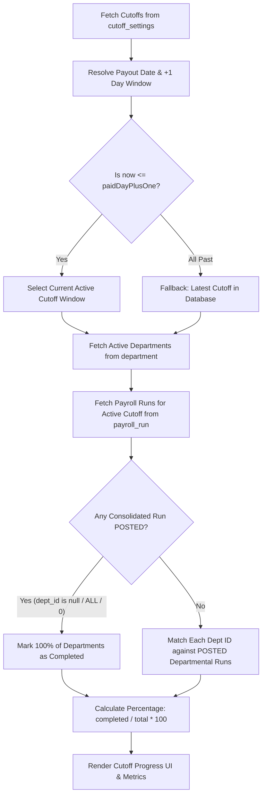

# How to Compute Current Cutoff Payroll Progress

This technical guide outlines the architecture, mathematical formulas, business rules, and step-by-step logic used across the Payroll System to compute the **Current Cutoff Payroll Progress** metric.

---

## 1. Overview & Purpose

The **Current Cutoff Payroll Progress** is a key operational KPI displayed on the Executive Dashboard ([CutoffProgressCard.tsx](file:///c:/Users/ace_c/Desktop/Vertex%20Files/system/payroll_system/modules/dashboard/components/CutoffProgressCard.tsx)) and the Unified Enterprise Status Portal ([OverallStatusBanner.tsx](file:///c:/Users/ace_c/Desktop/Vertex%20Files/system/payroll_system/modules/unified/payroll-status/components/OverallStatusBanner.tsx)).

It answers three fundamental questions for HR and Executives in real time:
1. **Which payroll cutoff is currently active and within its operational window?**
2. **What percentage of company departments have their payroll finalized and `POSTED`?**
3. **Which specific departments are completed vs. still pending review/processing?**

---

## 2. Core Architectural Flow



---

## 3. Database Entities & Schemas

The progress computation aggregates data across three core tables in Directus:

### 3.1 `cutoff_settings`
Stores the calendar configuration for payroll cycles (typically two cutoffs per month):
- `id` (int): Primary key of the cutoff.
- `cutoff_type` (varchar): `'FIRST'` (prev 26th to 10th) or `'SECOND'` (11th to 25th).
- `month` (int): 1–12.
- `year` (int): Calendar year.
- `start_date` (date): Period start date (e.g., `2026-10-11`).
- `end_date` (date): Period end date (e.g., `2026-10-25`).
- `payout_date` (date | null): Target salary disbursement day (e.g., `2026-10-31`).

### 3.2 `department`
Defines operational units in the organization:
- `department_id` or `id` (int): Department identifier.
- `department_name` or `name` (varchar): Name of the department.
- `is_delete` or `is_deleted` (tinyint/boolean): Soft delete flag (`1` = excluded, `0` = active).

### 3.3 `payroll_run`
Tracks calculation cycles and posting lifecycles:
- `payroll_run_id` or `id` (int): Run identifier.
- `cutoff_id` (int): Foreign key to `cutoff_settings.id`.
- `cutoff_start` / `cutoff_end` (date): Date range fallback.
- `department_id` (int | null | string): Specific department ID, or `null`/`0`/`"ALL"` for consolidated runs.
- `status` (varchar): Lifecycle stage (`'DRAFT'`, `'PENDING_CHECKER'`, `'PENDING_APPROVER'`, `'PROCESSED'`, `'POSTED'`).
- `headcount` (int): Total employees covered.
- `total_gross` / `total_net` / `total_deductions` (decimal): Financial totals.

---

## 4. Step-by-Step Computation Algorithm

The algorithm is implemented in [dashboardService.ts](file:///c:/Users/ace_c/Desktop/Vertex%20Files/system/payroll_system/modules/dashboard/providers/dashboardService.ts) and the unified payroll status route [route.ts](file:///c:/Users/ace_c/Desktop/Vertex%20Files/system/payroll_system/app/api/unified/payroll-status/route.ts).

### Step 1: Active Cutoff Window Identification (+1 Day Rule)

A cutoff is considered **currently active** from its start date until **23:59:59 of the day following its payout date** (`paidDayPlusOne`).

1. **Resolve Payout Date**:
   If `cutoff.payout_date` is explicitly defined, parse it. If null, derive it by business convention:
   $$\text{Payout Date} = \begin{cases} \text{15th of the payroll month}, & \text{if } \text{cutoff\_type} = \text{'FIRST'} \\ \text{Last day of the payroll month}, & \text{if } \text{cutoff\_type} = \text{'SECOND'} \\ \text{end\_date} + 5 \text{ days}, & \text{otherwise} \end{cases}$$

2. **Compute +1 Day Buffer (`paidDayPlusOne`)**:
   $$\text{paidDayPlusOne} = \text{Payout Date} + 1 \text{ day (set to 23:59:59.999)}$$

   > **Why the +1 day window?**
   > This ensures that on the actual disbursement date (and the subsequent audit day), administrators still see the progress, totals, and stats of the disbursed cutoff before the view advances to the next upcoming cycle.

3. **Window Selection**:
   Sort all available cutoffs chronologically by `start_date` ascending.
   Find the **first cutoff** where:
   $$\text{currentTime} \le \text{paidDayPlusOne}$$

   *Fallback Rule*: If all cutoffs in the database have their `paidDayPlusOne` in the past, default to the **latest cutoff** in the system.

---

### Step 2: Department Scope Filtering

Fetch all departments from the database and filter out soft-deleted records:

```typescript
const activeDepartments = departments.filter((dept) => {
  const del = dept.is_delete ?? dept.is_deleted;
  return !(del === 1 || del === true || del === "1" || del?.data?.[0] === 1);
});

const totalDepartments = activeDepartments.length;
```

---

### Step 3: Determining Department Completion

1. Query all `payroll_run` rows associated with the active cutoff:
   - Primary query: `filter[cutoff_id][_eq] = activeCutoff.id`
   - Secondary fallback: `filter[cutoff_start][_eq] = activeCutoff.start_date` AND `filter[cutoff_end][_eq] = activeCutoff.end_date`

2. Filter for posted runs:
   $$\text{Posted Runs} = \{ r \in \text{Runs} \mid \text{r.status.toUpperCase}() = \text{'POSTED'} \}$$

3. **Check for Consolidated Run**:
   A consolidated run processes all departments in a single master batch:
   $$\text{isConsolidatedPosted} = \exists r \in \text{Posted Runs} \text{ such that } r.\text{department\_id} \in \{\text{null}, 0, \text{"ALL"}\}$$

4. **Evaluate Each Active Department**:
   For each department $d \in \text{Active Departments}$:
   $$\text{isCompleted}(d) = \text{isConsolidatedPosted} \lor (d.\text{id} \in \text{postedDeptIdSet})$$

---

### Step 4: Progress Percentage Calculation

$$\text{Percentage} = \begin{cases} \text{round}\left( \dfrac{\text{Completed Departments}}{\text{Total Departments}} \times 100 \right), & \text{if } \text{Total Departments} > 0 \\ 0, & \text{if } \text{Total Departments} = 0 \end{cases}$$

Clamped within the range:
$$\text{Display Percentage} = \min(100, \max(0, \text{Percentage}))$$

---

## 5. Status Classification Matrix

Based on the calculated metrics, the system derives user-friendly statuses and badges:

| Condition | Status Code | Label / Trend Text | UI Badge Color |
| :--- | :--- | :--- | :--- |
| `completedDepartments == totalDepartments` ($100\%$) | `COMPLETED` | `All Clear` / `All Depts Posted` | Emerald / Green |
| `completedDepartments > 0` and `< totalDepartments` | `IN_PROGRESS` | `X/Y Done` | Blue / Indigo |
| `completedDepartments == 0` and runs exist in review | `IN_PROGRESS` | `Pending Checker / Approver` | Amber / Orange |
| `completedDepartments == 0` and runs exist in draft | `IN_PROGRESS` | `Drafting` | Slate / Blue |
| `matchingRuns.length == 0` | `PENDING` | `Not Started` | Slate / Amber |

---

## 6. Reference Implementation (TypeScript)

Here is the exact reference logic used in [dashboardService.ts](file:///c:/Users/ace_c/Desktop/Vertex%20Files/system/payroll_system/modules/dashboard/providers/dashboardService.ts):

```typescript
import { format } from "date-fns";

export interface DepartmentProgressItem {
  id: number;
  name: string;
  isCompleted: boolean;
  status?: string;
}

export interface CutoffProgressData {
  cutoffId: number | null;
  cutoffTitle: string;
  cutoffType: string | null;
  startDate: string | null;
  endDate: string | null;
  payoutDate: string | null;
  paidDayPlusOne: string | null;
  isWindowActive: boolean;
  totalDepartments: number;
  completedDepartments: number;
  percentage: number;
  departments: DepartmentProgressItem[];
}

export function computeCutoffPayrollProgress(
  cutoffs: any[],
  departments: any[],
  payrollRuns: any[],
  now = new Date()
): CutoffProgressData {
  // 1. Filter active departments
  const activeDepartments = departments.filter((d) => {
    const del = d.is_delete ?? d.is_deleted;
    return !(del === 1 || del === true || del === "1" || del?.data?.[0] === 1);
  });

  // 2. Map cutoff windows with payout dates & +1 day boundary
  const cutoffWindows = cutoffs
    .map((c) => {
      const id = Number(c.id);
      const startDateStr = c.start_date ? String(c.start_date).slice(0, 10) : null;
      const endDateStr = c.end_date ? String(c.end_date).slice(0, 10) : null;
      let payoutDate: Date | null = null;

      if (c.payout_date) {
        const parts = String(c.payout_date).slice(0, 10).split("-");
        payoutDate = new Date(Number(parts[0]), Number(parts[1]) - 1, Number(parts[2]));
      } else if (endDateStr) {
        const endParts = endDateStr.split("-");
        const y = Number(endParts[0]);
        const m = Number(endParts[1]) - 1;
        const type = String(c.cutoff_type || "").toUpperCase();
        if (type === "FIRST") {
          payoutDate = new Date(y, m, 15);
        } else if (type === "SECOND") {
          payoutDate = new Date(y, m + 1, 0); // Last day of month
        } else {
          payoutDate = new Date(new Date(y, m, Number(endParts[2])).getTime() + 5 * 86400000);
        }
      }

      let paidDayPlusOne: Date | null = null;
      if (payoutDate) {
        paidDayPlusOne = new Date(payoutDate.getTime() + 86400000);
        paidDayPlusOne.setHours(23, 59, 59, 999);
      }

      return { cutoff: c, id, startDateStr, endDateStr, payoutDate, paidDayPlusOne };
    })
    .filter((cw) => cw.id && cw.startDateStr)
    .sort((a, b) => new Date(a.startDateStr!).getTime() - new Date(b.startDateStr!).getTime());

  // 3. Find current window (now <= paidDayPlusOne) or fallback to latest
  let currentWindow = cutoffWindows.find((cw) => cw.paidDayPlusOne && now.getTime() <= cw.paidDayPlusOne.getTime());
  if (!currentWindow && cutoffWindows.length > 0) {
    currentWindow = cutoffWindows[cutoffWindows.length - 1];
  }

  if (!currentWindow) {
    return {
      cutoffId: null,
      cutoffTitle: "No Active Cutoff",
      cutoffType: null,
      startDate: null,
      endDate: null,
      payoutDate: null,
      paidDayPlusOne: null,
      isWindowActive: false,
      totalDepartments: activeDepartments.length,
      completedDepartments: 0,
      percentage: 0,
      departments: [],
    };
  }

  // 4. Filter runs for the active window
  const matchingRuns = payrollRuns.filter((r) => {
    if (Number(r.cutoff_id) === currentWindow.id) return true;
    if (currentWindow.startDateStr && currentWindow.endDateStr) {
      return (
        String(r.cutoff_start).slice(0, 10) === currentWindow.startDateStr &&
        String(r.cutoff_end).slice(0, 10) === currentWindow.endDateStr
      );
    }
    return false;
  });

  const postedRuns = matchingRuns.filter((r) => String(r.status || "").toUpperCase() === "POSTED");

  // 5. Consolidated check
  const isConsolidatedPosted = postedRuns.some(
    (r) => r.department_id == null || r.department_id === "ALL" || Number(r.department_id) === 0
  );

  const postedDeptIdSet = new Set<number>();
  postedRuns.forEach((r) => {
    if (r.department_id != null) postedDeptIdSet.add(Number(r.department_id));
  });

  // 6. Department breakdown & counts
  const deptItems: DepartmentProgressItem[] = activeDepartments.map((d) => {
    const deptId = Number(d.department_id || d.id);
    const isCompleted = isConsolidatedPosted || postedDeptIdSet.has(deptId);
    return {
      id: deptId,
      name: String(d.department_name || d.name || `Department #${deptId}`),
      isCompleted,
      status: isCompleted ? "POSTED" : "PENDING",
    };
  });

  const completedCount = isConsolidatedPosted ? activeDepartments.length : deptItems.filter((i) => i.isCompleted).length;
  const totalCount = activeDepartments.length;
  const percentage = totalCount > 0 ? Math.round((completedCount / totalCount) * 100) : 0;

  return {
    cutoffId: currentWindow.id,
    cutoffTitle: `${currentWindow.cutoff.cutoff_type || "Cutoff"} #${currentWindow.id}`,
    cutoffType: currentWindow.cutoff.cutoff_type,
    startDate: currentWindow.startDateStr,
    endDate: currentWindow.endDateStr,
    payoutDate: currentWindow.payoutDate ? format(currentWindow.payoutDate, "yyyy-MM-dd") : null,
    paidDayPlusOne: currentWindow.paidDayPlusOne ? format(currentWindow.paidDayPlusOne, "yyyy-MM-dd") : null,
    isWindowActive: currentWindow.paidDayPlusOne ? now.getTime() <= currentWindow.paidDayPlusOne.getTime() : true,
    totalDepartments: totalCount,
    completedDepartments: completedCount,
    percentage,
    departments: deptItems,
  };
}
```

---

## 7. Multi-Entity Enterprise Aggregation

In the multi-company architecture ([route.ts](file:///c:/Users/ace_c/Desktop/Vertex%20Files/system/payroll_system/app/api/unified/payroll-status/route.ts)):
1. Each company instance calculates its own departmental completion percentage ($P_c$).
2. A company is marked `COMPLETED` when its progress is $100\%$ ($P_c = 100\%$).
3. The **Enterprise Overall Completion Rate** is calculated as:
   $$\text{Overall Rate} = \begin{cases} \text{round}\left( \dfrac{\text{Completed Companies}}{\text{Online Companies}} \times 100 \right), & \text{if } \text{Online Companies} > 0 \\ 0, & \text{otherwise} \end{cases}$$

---

## 8. Summary Checklist for Implementation / Debugging

When investigating or adding new cutoff progress tracking:
- [x] Check if `cutoff_settings` has records for the current month and year.
- [x] Verify whether `payout_date` or the default computation (15th or End-of-Month) covers the current date + 1 day.
- [x] Ensure deleted departments (`is_delete = 1`) are excluded from `totalDepartments`.
- [x] Check if the run has reached `status = 'POSTED'` (drafts and pending approvals do not count as completed).
- [x] Confirm whether a company-wide consolidated run exists (`department_id IS NULL`), which satisfies all departments at once.
- [x] Format dates in the UI using `date-fns` `format()` (e.g. `Oct 25, 2026`).
